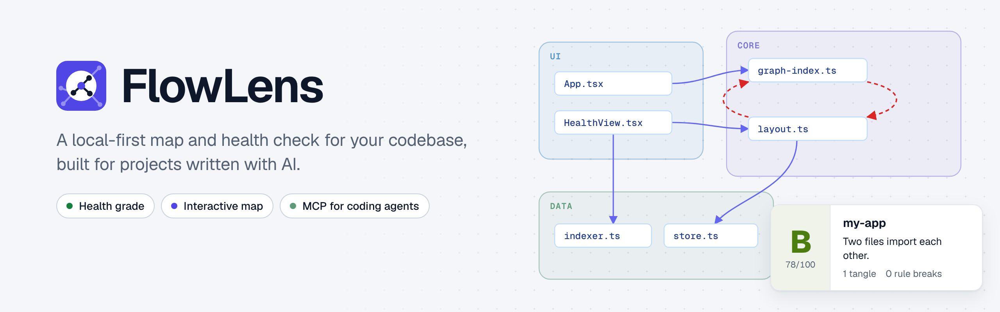
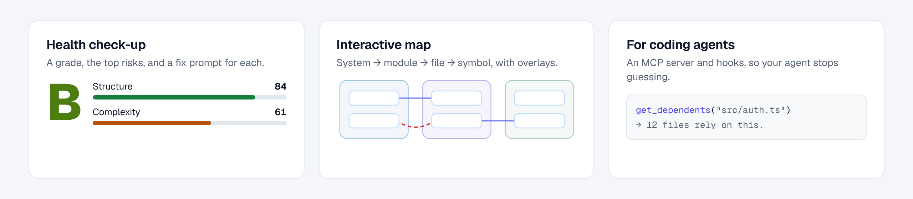

<p align="center">
  <picture>
    <source media="(prefers-color-scheme: dark)" srcset="assets/brand/flowlens-banner-dark.png">
    
  </picture>
</p>

# FlowLens

**A local-first map and health check for your codebase, built for projects
written with AI.**

You prototyped something fast with Claude Code, Cursor, Lovable or Bolt. It
works, but you no longer know how the pieces fit together, which files
everything depends on, or where the tangles are. FlowLens indexes your repo,
gives it a plain-English health grade with ready-to-paste fix prompts, draws
it as an interactive map, and gives your coding agent the same structural
knowledge through an MCP server and Claude Code hooks, so it stops guessing.

- **Health check-up**: a grade, a score breakdown and the top risks
  (tangles, hard-to-follow code, fragile hubs, oversized files, rule breaks),
  each with a fix prompt for your AI assistant (`flowlens report`, or the
  Health screen in the explorer).
- **Interactive map**: one browser app for all your projects. Home shows every
  project's health; each project has a Health screen and a Map
  (system → module → file → symbol, with overlays for quality, recent
  changes, tangles and rule breaks).
- **For coding agents**: an MCP server with 14 tools, health and context
  resources, and optional Claude Code hooks that add context to prompts and
  check every edit, so your agent stops guessing.
- **CI-friendly checks**: `flowlens check` exits non-zero on dependency
  cycles or architecture-rule violations. Exports to JSON, Graphviz DOT and
  Mermaid.

<p align="center">
  <picture>
    <source media="(prefers-color-scheme: dark)" srcset="assets/brand/flowlens-features-dark.png">
    
  </picture>
</p>

> **Status:** early release (0.1), published on npm as
> [`@polymathik/flowlens`](https://www.npmjs.com/package/@polymathik/flowlens).
> The command it installs is `flowlens`.

## Quickstart

Requires Node.js 20 or newer.

```bash
cd your-project
npm i -D @polymathik/flowlens                         # or: npm i -g @polymathik/flowlens
npx flowlens init      # index the code, infer layers → .flowlens/, offer to connect your coding agent
npx flowlens canvas    # open the explorer in your browser
npx flowlens report    # the same health check-up as Markdown in the terminal
```

Using Claude Code or Codex? Answer **yes** when `init` offers to connect it,
then restart the agent in that folder. [Connect your coding
agent](#connect-your-coding-agent) covers solo and team setups.

`flowlens canvas` signs your browser in to the local FlowLens daemon and
opens the explorer at **http://127.0.0.1:4280** (or another free port, see
[The daemon](#the-daemon)). Nothing is built or served from your project.

## The explorer

| Screen | What you see |
|---|---|
| **Home** | A card per registered project with its grade and top risk, worst first. Missing or moved projects explain themselves and can be removed. |
| **Health** (per project) | Grade and score breakdown, then findings ranked by urgency. Each finding says why it matters in plain English, lists the exact files and lines, has **Copy fix prompt**, and **Show on map**. |
| **Map** (per project) | The dependency map: double-click to drill from system to module to file to symbol. Overlays: code quality, recent changes, hotspots, dependency cycles, rule breaks, interface diff. Search (⌘K), rules editor, PNG/SVG export, light and dark themes. |

Links from MCP tools and `flowlens report` ("Show on map") open the right
project and view, e.g. `http://127.0.0.1:4280/#/p/<project-id>/map/file/src%2Fapp.ts?overlay=cycles`.
The explorer only works in a browser signed in through `flowlens canvas`; if
you open a link without a session, the page tells you to run
`flowlens canvas` (sign-in links work once, for 60 seconds, and sessions end
when the daemon restarts).

Add `--watch` to keep the project re-indexing while the command runs; open
tabs update live.

## Health report

```bash
npx flowlens report                         # Markdown, top 10 findings
npx flowlens report --format html --out health.html
npx flowlens report --format json           # the HealthReport contract
```

Findings are written for people who did not hand-write their code. Loops
made only of `import type` lines or type annotations are listed as
information (they disappear at runtime), and lockfiles, generated or
minified files and data files (JSON, YAML) are never flagged for size.

## Connect your coding agent

FlowLens gives an agent two things: an **MCP server** (14 tools it can call to
ask the graph "who depends on this?", "what happens when X runs?") and
**hooks** (they add a map of the relevant code to every prompt, re-index each
edit, and hold edits to risky files until the agent has looked them up).
`flowlens init` offers to set up both; you can also do it any time:

```bash
npx flowlens agent install claude-code     # Claude Code
npx flowlens agent install codex           # Codex (project config; see the Codex note)
npx flowlens agent status                  # what is connected, per agent
npx flowlens agent uninstall claude-code   # removes only FlowLens's entries
```

Nothing is changed without your say-so (`init` asks first; installing is an
explicit command), and every file FlowLens edits is backed up first
(`*.flowlens-backup-*`). FlowLens never installs anything from `npm install`.

### Just me (solo developer)

```bash
cd your-project
npm i -D @polymathik/flowlens                      # or npm i -g @polymathik/flowlens
npx flowlens init          # index → "Connect Claude Code now? [Y/n]" → yes
npx flowlens canvas        # open the explorer
```

Then **restart Claude Code in that folder** (it reads MCP servers and hooks at
startup) and run `/mcp`: `flowlens` should be listed as connected. Ask
something like *"what depends on the session module?"* and the agent should
call `mcp__flowlens__get_dependents`. Personal setup stays out of git: the MCP
server is registered with `claude mcp add --scope local` (or written to
`.mcp.json` if the `claude` CLI is not installed) and the hooks go to
`.claude/settings.local.json`.

Skip the prompt with `flowlens init --yes` (connect Claude Code),
`--agents claude-code,codex`, or `--no-agent`.

### A team

One person sets it up and commits the shared files; everyone else only installs
dependencies.

```bash
# the person setting it up
npm i -D @polymathik/flowlens
npx flowlens init --shared --agents claude-code    # or: flowlens agent install claude-code --shared
git add package.json package-lock.json .mcp.json .claude/settings.json
git commit -m "Connect FlowLens"

# every teammate
npm install
npx flowlens init --no-agent                       # builds their local map (.flowlens/ is not committed)
```

`--shared` writes `.mcp.json` and `.claude/settings.json` with a portable
`npx --no-install flowlens …` command, so the same files work on every
machine. On first use Claude Code asks each teammate to approve the project's
`.mcp.json` server: they accept once. Add `.flowlens/` to `.gitignore`.
If someone prefers personal settings, a local install (without `--shared`)
takes precedence on their machine.

### What the agent sees

- **At session start and on every prompt**, a short block: the code relevant
  to the prompt, a one-line health headline, and the project convention: *call
  `mcp__flowlens__get_dependents` on the symbols you will change; for a feature
  question call `mcp__flowlens__get_context` with the feature name*. The tools
  are named exactly because Claude Code loads MCP tools on demand.
- **After every edit**, the file is re-indexed and new dependency cycles or
  rule breaks are reported (`--strict`: new ones block).
- **Before an edit to a risky file** (the *edit gate*): if FlowLens has not been
  queried for that file in this session, the edit is held with a message naming
  the exact tool to call. A query for the file (`get_dependents`,
  `get_context`, `traverse` or `get_module_interface`) clears it. The gate
  covers hotspot files and any paths you list, never tests, docs or config, and
  **fails open**: if the tools are missing, anything errors, or the same file
  was held 3 times, the edit goes through with a visible note. It is a
  guardrail, not a security boundary (an agent can still edit through the
  shell).

Tune or switch off the gate in `.flowlens/agent.json` (all fields optional):

```json
{
  "version": 1,
  "gate": {
    "enabled": true,
    "paths": ["packages/core/**"],
    "exclude": ["**/*.generated.ts"],
    "hotspots": 10,
    "max_denials": 3
  }
}
```

`FLOWLENS_GATE=off` disables it for one shell; `agent install … --no-gate`
leaves it out entirely.

### Measure whether it helps

```bash
npx flowlens agent stats               # last sessions: FlowLens calls, searches, blocked edits, tokens
npx flowlens agent stats --session <id>
npx flowlens agent stats --history     # compares your past Claude Code sessions with vs without FlowLens
```

`--history` reads Claude Code's own session files for this project, so it
works even for sessions before you installed the hooks. It compares averages
and says when there is not enough data; treat it as a signal, not proof.
Sessions started from a parent or sub-folder of the project, and subagent
work, are not counted.

### Codex

`flowlens agent install codex` writes the MCP server and hooks to
`<project>/.codex/`. Codex loads project config only for **trusted projects**,
and asks you to review new hooks once: run `/hooks` in Codex and approve
FlowLens's. Codex support follows OpenAI's published config and hook formats
but has not been run against a live Codex in FlowLens's own tests; if
something does not connect, `flowlens agent status` and `flowlens doctor`
say what is missing. `agent stats` reads FlowLens's own log for Codex (its
transcript format is not supported yet).

### Cursor, Windsurf, Gemini CLI and other MCP clients

Any MCP client can use the 14 tools. FlowLens does not install hooks for
these. Add this server entry to the client's MCP config (file locations vary by
client and version, so check its docs; these snippets have not been verified
against each client here):

```json
{
  "mcpServers": {
    "flowlens": { "command": "npx", "args": ["--no-install", "flowlens", "serve"] }
  }
}
```

Typical locations: Cursor `.cursor/mcp.json`, Windsurf
`~/.codeium/windsurf/mcp_config.json`, Gemini CLI `.gemini/settings.json`.

### The tools

`get_context`, `get_dependents`, `get_module_interface`, `annotate`,
`traverse`, `detect_cycles`, `get_metrics`, `diff_interface`,
`check_architecture`, `get_summary`, `get_hotspots`, `get_layer_map`,
`trace_flow` (what happens when X runs? / what triggers X?),
`list_entry_points`. Resources: `flowlens://health`, `flowlens://architecture`,
`flowlens://hotspots`, `flowlens://changed-context`; prompts
`flowlens-plan-task` and `flowlens-review-change`. `flowlens serve` indexes the
project on first use if needed.

## The daemon

One small local service (the FlowLens daemon) owns every project's graph
database, so `serve`, `watch`, `check`, `index`, hooks and the explorer can
all run at the same time without lock errors. Any command that needs it
starts it automatically; it exits after an hour without use.

- Listens on `127.0.0.1` only, port **4280** by default (set
  `FLOWLENS_DAEMON_PORT` to choose another; if the port is busy it picks a
  free one). Every request needs a random token or a browser session.
- `flowlens daemon status` lists running daemons (one per installed FlowLens
  version, so different versions never stop each other) and which project
  graphs are open; `flowlens daemon stop` stops this version's daemon
  (`--all` also stops idle daemons from other versions); `flowlens daemon
  start` starts it in the background.
- `--no-daemon` (or `FLOWLENS_NO_DAEMON=1`) makes a command open the
  database directly, for CI or scripts. Only one such process can use a
  project at a time.
- `FLOWLENS_HOME` (default `~/.flowlens`) holds the project registry and the
  daemon's files.

## Commands

Every command accepts `-h, --help`. Most accept `--no-daemon`.

| Command | What it does | Options |
|---|---|---|
| `flowlens init` | Create `.flowlens/`, index the repo, infer architecture layers, register the project, offer to connect your coding agent | `--force` (start over), `--ai`, `--provider anthropic\|openai\|ollama`, `--model <m>`, `--no-daemon`, `--yes` (connect Claude Code without asking), `--agents claude-code,codex`, `--no-agent`, `--shared` |
| `flowlens index` | Incremental re-index after changes | `--no-daemon` |
| `flowlens report` | Plain-English health check-up with fix prompts | `--format md\|html\|json`, `--out <file>`, `--top <n>` (10), `--churn-days <n>` (90), `--no-git`, `--no-daemon` |
| `flowlens canvas` | Open the explorer (all registered projects) in the browser | `--no-open` (print the sign-in link), `--watch`, `--debounce <ms>` (300), `--dev` and `--port <port>` (contributors only: Vite UI on `--port`, default 5173) |
| `flowlens check` | Cycle detection and architecture validation; exit 0 clean, 1 issues, 2 error | `--format text\|json`, `--cycles`, `--architecture`, `--severity low\|medium\|high`, `--scope <path>`, `--include-type-only`, `--no-daemon` |
| `flowlens serve` | MCP server on stdio for coding agents | `--watch`, `--transport stdio`, `--no-daemon` |
| `flowlens watch` | Re-index on file changes | `--debounce <ms>` (300), `--no-daemon` |
| `flowlens export` | Export the graph | `--format json\|dot\|mermaid`, `--scope <path>`, `--relations <types>`, `--no-metrics`, `--output <file>`, `--no-daemon` |
| `flowlens snapshot` | Store a graph snapshot for the current git HEAD (used by interface diffs) | `--force`, `--list`, `--keep <n>` (20), `--no-daemon` |
| `flowlens doctor` | Diagnose setup: graph, config, MCP server, AI, environment | `--format text\|json` |
| `flowlens daemon start\|stop\|status` | Manage the local graph service | `start --foreground`, `status --json` |
| `flowlens projects list\|remove\|rename` | Manage registered projects (`remove` keeps `.flowlens/`) | `list --json`; `remove <project>`; `rename <project> <name>` |
| `flowlens agent context` | Compact code context for coding agents (used by hooks) | `--prompt`, `--changed <files>`, `--git`, `--event`, `--max-items`, `--budget`, `--format markdown\|json`, `--root`, `--hook`, `--no-daemon` |
| `flowlens agent guard` | Graph risk for changed files (used by hooks) | `--changed <files>`, `--git`, `--reindex`, `--strict`, `--min-risk none\|low\|medium\|high`, `--max-items`, `--budget`, `--format`, `--root`, `--hook`, `--no-daemon` |
| `flowlens agent baseline` | Show or reset the strict-mode baseline of pre-existing issues | `--reset`, `--format`, `--root`, `--no-daemon` |
| `flowlens agent install claude-code\|codex` | Connect an agent: register the MCP server and install hooks (with the edit gate) | `--shared` (committed, team-wide), `--command <cmd>`, `--force`, `--no-mcp`, `--no-hooks`, `--no-gate`, `--format`, `--root` |
| `flowlens agent uninstall claude-code\|codex` | Remove only the entries FlowLens added | `--shared`, `--local`, `--format`, `--root` |
| `flowlens agent status` | Which agents are connected here (MCP server, hooks, gate) | `--format`, `--root` |
| `flowlens agent stats` | Did agents use FlowLens, and what did it cost? | `--session <id>`, `--since 7d`, `--limit <n>`, `--history`, `--format text\|json`, `--root` |
| `flowlens agent gate\|record` | Hook entry points (edit gate; query recorder). Not run by hand | `--hook`, `--agent`, `--root` |

## Language support

What the golden tests verify (TypeScript/JavaScript, Python, Java and Go
are fully linked across files; other languages are indexed at file level
with same-file links only):

| Language | Entities | Cross-file relations | Same-file only | Complexity |
|---|---|---|---|---|
| TypeScript / TSX | file, class, interface, function, method, field, variable, parameter, type, enum, namespace, decorator | import (relative, `.js`→`.ts`, tsconfig paths, workspaces, barrels, `import type`), extend, implement, override, call, create, throw, return | contain, decorate, mixin | yes |
| JavaScript (ESM + CommonJS) | as TS minus types | import (ESM, `require`), extend, override, call, create | contain, use | yes |
| Python | file, class, function, method, field, variable, decorator | import (absolute, relative, `__init__` re-exports), extend, override, call, create | contain, decorate | yes |
| Java | file, class, interface, enum, method, field, annotation | import, extend, implement, override, call, create, throw, return, parameter | contain, decorate, use | yes |
| Go | file, struct, interface, function, method, field, variable | import (go.mod paths), call, create | contain | yes |
| Kotlin, C#, PHP, Rust, C, C++, Swift, Scala, Ruby, Bash | entities | none (imports recorded as unresolved) | names in the same file | cyclomatic where measured |
| JSON, YAML, CSS, HTML | file | none | none | none |

## Privacy: local-first

- Indexing, analysis, the explorer, the daemon and the MCP server run
  entirely on your machine. **No network calls** during indexing or
  analysis, and no telemetry.
- The daemon binds `127.0.0.1` only and requires a token (CLI) or a
  sign-in cookie (browser).
- The only optional network use is `flowlens init --ai`, which sends
  **graph topology only** (file paths, cluster sizes, edge counts, never
  source code) to the provider you choose; Ollama keeps even that local.
- What FlowLens writes:
  - `.flowlens/` in each project: the graph, manifest, snapshots,
    architecture rules, caches. Add it to `.gitignore`.
  - `~/.flowlens/` (or `$FLOWLENS_HOME`): `projects.json` (the registry of
    project paths), `daemon-p<key>.json` per FlowLens version (port, pid
    and token, mode 0600), its log, and short-lived 0600 browser sign-in
    files under `run/`.
  - Only if you connect an agent: the MCP entry (`claude mcp add` writes
    Claude Code's own `~/.claude.json`; with `--shared` or without the
    `claude` CLI, `.mcp.json`; for Codex `.codex/config.toml`), hooks in
    `.claude/settings.local.json` (`.claude/settings.json` with `--shared`;
    `.codex/hooks.json` for Codex), a `*.flowlens-backup-*` copy of any file it
    changed, entries in `.git/info/exclude` for the personal files, and, once
    hooks run, `.flowlens/agent-ledger/<session>.jsonl` (which tools were
    called and which files were gated; no prompts or code, deleted after 14
    days). `flowlens agent stats` also reads Claude Code's own session files
    under `~/.claude/projects/`, locally.

## Troubleshooting

| Problem | Fix |
|---|---|
| "No FlowLens map found for this folder" | Run `npx flowlens init` in the project root first. |
| The explorer says you need to sign in | Run `npx flowlens canvas` again; links work once, for 60 seconds, and sessions end when the daemon restarts. |
| The explorer is not on port 4280 | Port 4280 was busy, so the daemon picked a free port. `flowlens daemon status` shows it; `flowlens canvas` always prints the right link. |
| "busy" / graph locked | A `--no-daemon` process holds the project's database. Stop it, or run without `--no-daemon`. |
| Results look stale after big changes | `npx flowlens index` (or keep `flowlens canvas --watch` / `serve --watch` running). |
| The daemon misbehaves after an upgrade | `npx flowlens daemon stop`; the next command starts the new version. |
| The agent does not call the FlowLens tools | Restart it in the project folder, then `npx flowlens agent status` and `/mcp` (Claude Code). Teammates must approve the project's `.mcp.json` server once. |
| An edit is held by FlowLens and the tools are missing | The gate lets it through after 3 tries with a note. Fix the connection (`agent status`), or `FLOWLENS_GATE=off`, or set `"gate": {"enabled": false}` in `.flowlens/agent.json`. |
| Codex ignores the hooks | The project must be trusted, and the hooks approved once with `/hooks`. |
| Anything else | `npx flowlens doctor` checks the graph, config, MCP server and environment. |

## Development

```bash
npm ci
npm run lint            # tsc --noEmit for the CLI and the canvas
npm test                # vitest
npm run build           # tsc → dist/, vite build → dist/canvas/app
npm run test:canvas:e2e # Playwright scenarios against the built explorer
npm run smoke:pack      # npm pack + clean install + CLI/explorer smoke
node dist/cli/index.js --help
```

- Explorer with hot reload (source checkout only):
  `node dist/cli/index.js canvas --dev` (Vite on `--port`, default 5173,
  proxying the API to the daemon).
- `src/contracts/` is the source of truth for every component boundary.
  See [CONTRIBUTING.md](CONTRIBUTING.md).
- Brand: the banner, features image, logo lockups, favicon and social
  preview live in `assets/brand/` (light and dark pairs, drawn from the
  FlowLens design system). The explorer's mark is
  `src/canvas/components/shared/LogoMark.tsx`, which follows the theme
  through `--fl-accent`; its favicon is `src/canvas/public/favicon.svg`.
  `assets/brand/flowlens-social-preview.png` is the GitHub social preview
  (Settings → Social preview).

## License

[Apache License 2.0](LICENSE). Copyright 2026 Sailalith Sarupuri; see
[NOTICE](NOTICE).
